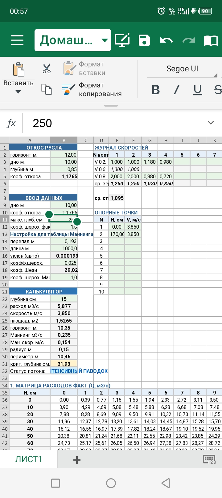

# Open Channel Hydraulics & Hydrometry Calculator (Excel / VBA)

Инженерный калькулятор в формате Excel (`.xlsm`) для автоматизации гидрометрических замеров, расчета пропускной способности открытых каналов по формулам Маннинга/Шези и автоматического построения тарировочных таблиц. 

Проект разработан как для настольного использования (ПК), так и для быстрой работы прямо в полевых условиях через мобильное приложение Excel.

---

## ✨ Основной функционал (Features)

1. **Журнал скоростей (Гидрометрия):**
   * Обработка «сырых» замеров гидрометрической вертушкой на вертикалях.
   * Гибкий умный расчет средней скорости на вертикали: автоматическое переключение между **двухточечным методом** (по точкам 0.2H и 0.8H) и **трехточечным методом** (0.2H, 0.6H с двойным весом, 0.8H) в зависимости от заполнения данных.
   * Расчет средней скорости в створе по активным вертикалям с автоматическим скрытием пустых строк.

2. **Гидравлический калькулятор (Маннинг и Шези):**
   * Расчет основных гидравлических элементов: площадь живого сечения (F), смоченный периметр (χ), гидравлический радиус (R).
   * Определение критической глубины и автоматическое определение статуса потока (бурный/спокойный/стабильный режим).

3. **Матричный генератор тарировочных кривых:**
   * Автоматическое построение расходных характеристик Q = f(H) и скоростных матриц V = f(H) с шагом в 1 см для практического составления паспортов гидропостов.

---

## 🛠 Как это устроено внутри (Tech Stack)
* **Платформа:** Microsoft Excel (поддержка макросов `.xlsm`).
* **Логика:** Формулы Excel (`IF`, `AVERAGE`) адаптированные под полевой ввод + VBA-макрос для генерации масштабных тарировочных матриц.

---

## 🤝 Приглашение к сотрудничеству и развитию (Call for Collaboration)

Я начинающий специалист в сфере гидрологии и эксплуатации каналов. Этот проект создавался с целью упростить рутину полевых замеров, и я хочу сделать его максимально точным и полезным для сообщества. 

**Ищу единомышленников и опытных инженеров для совместного развития проекта!**

### 💡 В чем нужна помощь и экспертное мнение:
* **Методология тарирования русла:** Как с помощью этой таблицы более правильно и точно протарировать русло канала с учетом деформаций дна и заиления?
* **Расчет створа:** Перевод расчета средней скорости в створе с простого среднеарифметического на более точный метод (через интегральный расход и площади между вертикалями).
* **Учет шероховатости:** Корректная интеграция фактических коэффициентов шероховатости для различных типов крепления каналов (бетон, земляное русло, заросшие каналы).
* **Оптимизация VBA:** Улучшение кода макроса для ускорения генерации матриц.

Если у вас есть идеи, замечания или вы хотите поделиться знаниями — создавайте **Issues**, присылайте **Pull Requests** или пишите в обсуждениях проекта!

---

## 📝 Лицензия (License)
Проект распространяется совершенно бесплатно под лицензией **MIT**. Вы можете свободно использовать, изменять и распространять его в своих рабочих и учебных целях.
---

# Open Channel Hydraulics & Hydrometry Calculator (Excel / VBA) - English Description

An engineering calculator in Excel (`.xlsm`) designed to automate hydrometric measurements, compute open-channel discharge capacity using Manning and Chézy equations, and automatically generate rating curves.

This project is built for both desktop (PC) use and fast on-site field data entry via the Excel mobile app.

---

## ✨ Features

1. **Velocity Log (Hydrometry):**
   * Processes "raw" field data measured by a current meter on verticals.
   * Smart dynamic calculation of mean vertical velocity: automatically switches between the **two-point method** (0.2H & 0.8H) and the strict **three-point method** (0.2H, 0.6H with double weight, and 0.8H) depending on data entry.
   * Calculates the mean velocity of the cross-section based on active verticals, automatically hiding empty rows.

2. **Hydraulic Calculator (Manning & Chézy):**
   * Calculates key hydraulic parameters: cross-sectional area (F), wetted perimeter (χ), and hydraulic radius (R).
   * Determines critical depth and automatically identifies the flow state (critical, subcritical, supercritical, or stable regime).

3. **Rating Curve Matrix Generator:**
   * Automatically builds rating curves (Q = f(H)) and velocity matrices (V = f(H)) with a 1 cm step increment for practical gauging station passportization.

---

## 🛠 Tech Stack
* **Platform:** Microsoft Excel (with Macro enabled `.xlsm`).
* **Logic:** Excel formulas (`IF`, `AVERAGE`) optimized for mobile field entry + VBA script for generating large rating curve matrices.

---

## 🤝 Call for Collaboration & Knowledge Sharing

I am a beginner in the field of hydrology and open-channel operation. I created this project to simplify the routine of field measurements, and I want to make it as accurate and useful for the community as possible.

**I am looking for like-minded people and experienced engineers to develop this project together!**

### 💡 Areas where help and expert advice are needed:
* **Channel Calibration Methodology:** How to properly calibrate a canal bed using this Excel tool while accounting for bed deformation and siltation?
* **Cross-Section Velocity Calculation:** Transitioning the mean cross-section velocity calculation from a simple arithmetic mean to a more advanced integration method (using total discharge and area segments between verticals).
* **Roughness Coefficient Adjustment:** Proper integration of actual roughness coefficients (n) for various channel linings (concrete, earth beds, weed-grown channels).
* **VBA Optimization:** Refining the macro code to speed up the matrix generation.

If you have any ideas, suggestions, or want to share your expertise — feel free to open **Issues**, submit **Pull Requests**, or join the project discussions!

---

## 📝 License
This project is completely free and distributed under the **MIT License**. You are free to use, modify, and distribute it for both commercial and educational purposes.
